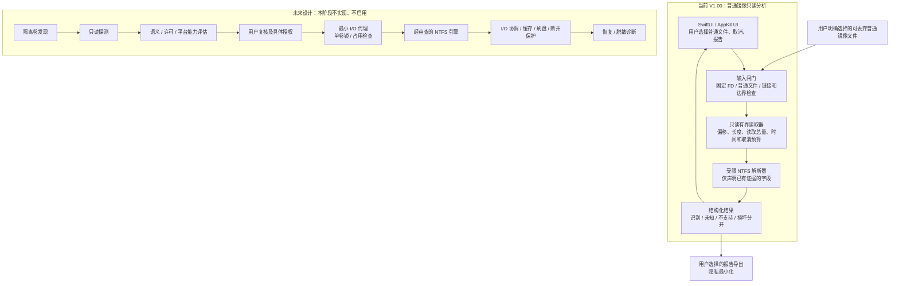
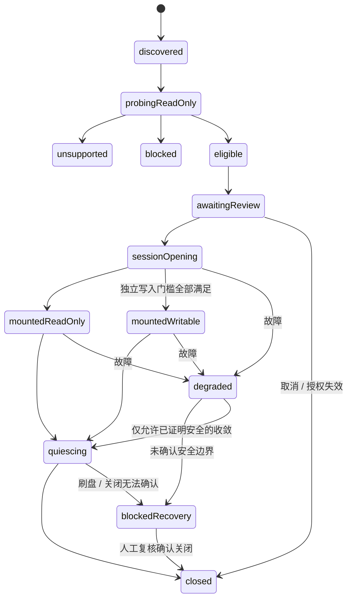

# 搞磁盘安全设计与能力边界

设计日期：2026-10-18。候选内部名 GaoCiPan；Bundle ID `com.gaoseries.GaoCiPan`；用户要求的初始版本 V1.00 / build 1。

## 1. 当前交付与研究结论

用户的本次直接请求授权制作、保存和本机安装“搞磁盘”普通镜像只读分析 App。原始需求中的真实 NTFS 读写产品、驱动、挂载、系统扩展和真实介质实验没有因此获得授权。V1.00 不提供这些能力，不采集系统登录密码，不改变 SIP、启动安全策略、TCC、fstab 或磁盘权限，不需要特权辅助进程。

本文是安全设计和验收门槛，**不作为已实现功能清单**。V1.00 实际解析的字段、限制、样本和通过的检查以随交付的源码、原型报告和测试输出为准；未有实现与样本证据的项目一律“未验证”。普通镜像能够被打开、引导字段能够被读取或 MFT 能够枚举，均不足以证明文件系统完整、兼容或可安全写入。

当前结论：推荐普通文件只读分析路线。可以继续补充只读解析、隔离测试与解释性 UI；不建议直接进入真实 NTFS 写盘开发。任何写盘路线必须另做引擎适配、许可、系统接入、恢复和硬件证据审查。未能证明写入安全时保持只读，必要时停止路线。

本文除用户需求和项目约束外，不引用外部技术结论。涉及未来引擎行为、系统接入、缓存及设备能力的内容均为**设计要求或待验证假定**，不能当成 Apple、NTFS 上游或厂商已经承诺的能力。版本、权限、许可证和发行结论应在路线研究文档中以检查日期及官方原始链接核实。

## 2. 当前与未来架构边界

| 模块 | 职责与输入 | 输出与禁止事项 |
|---|---|---|
| UI | 用户选择、进度、取消、结果解释 | 不直接控制块设备；不把系统打开成功或局部解析成功当业务完成 |
| 当前输入闸门 | 同一只读 FD 上校验文件类型、大小、身份；拒绝块/字符设备、链接及不合条件对象 | 只传只读抽象；解析器不能自行重新打开任意路径 |
| 有界读取器 | checked arithmetic、范围核验、读取预算、取消 | 不写源文件；拒绝越界、溢出、短读及身份变化 |
| 解析器 | 根据已核验字节解析少量结构，标记证据范围 | 不挂载、不修复、不执行镜像内路径、不跟随重解析点，不自动调用外部磁盘工具 |
| 结果层 | 将每个字段关联到偏移、长度、检查状态 | “未知”不转换为健康；错误报告不建议格式化用户磁盘 |
| 未来卷发现/探测 | 无写入地识别候选对象和平台能力 | 发现仅表示可见，不产生写授权 |
| 未来能力评估 | 根据引擎和卷特征建立逐项能力结论 | 未知、冲突或缺证据时拒绝写入 |
| 未来 I/O 代理 | 唯一允许接触已授权测试块设备的组件 | 不把设备句柄交给 UI；设备授权、锁、身份及生命周期受限 |
| 未来协调/恢复 | 会话锁、写入排序、缓存屏障、错误冻结和恢复记录 | 不承诺普通文件备份可回滚任意卷级元数据变化 |

未来 UI 与任何高权限/文件系统组件必须进程分离。能够取得块设备句柄的进程数量和生命周期应最少；其具体沙箱、签名、entitlement 和系统接入方式未定，须经官方文档和可得性审查。V1.00 没有该组件。

## 3. 文件系统语义能力与拒写矩阵

标记含义：**R** 是未来只读策略；**I** 是需要的识别证据；**P** 是源数据保留规则；**W** 是未来写入门槛；**E** 是要求的证据。下表全部属于设计目标；当前未在实现/原型报告中列明的识别和读取能力均为“未实现或未验证”。当前所有项目的写入均为**拒绝：V1.00 无写入接口**。

“保留”指源文件字节不被修改，不代表未来导出已经能保真重建 NTFS 对象。未支持的语义不能通过复制为普通文件、静默改名、丢流或放宽权限伪装为成功。

| 特性/状态 | R：读取策略 | I：识别要求 | P：保留要求 | W：未来拒写条件/门槛 | E：证据范围 |
|---|---|---|---|---|---|
| Dirty volume | 仅有界读取明确可解释的字段；结果标明不可判断健康 | 从已验证元数据识别 dirty 及未知状态，不以缺失当 clean | 保持标志与源字节 | dirty、未知标志或恢复状态不明即拒写；不自动清标志 | clean/dirty 合成样本、参考系统状态及反例 |
| 休眠 / Fast Startup | 只读分析，不改变休眠资料 | 所需标志、文件及组合证据由引擎设计确定；不能仅凭没看到文件判安全 | 保留原状态 | 已休眠、疑似休眠、无法排除状态均拒写 | 真实空白测试卷的多种关机状态；官方/引擎证据 |
| BitLocker | 未支持解密路径时停止文件系统解析，允许输出有证据的格式拒绝原因 | 独立格式识别；未知加密/容器不能当普通 NTFS | 不改加密头、不收集密钥 | 未提供经审查且有明确授权的支持即拒写 | 授权合成/测试加密样本；不保存真实恢复密钥 |
| EFS | 不把密文或不可解密对象报告成可读内容 | 文件属性及相关结构；识别覆盖率明确 | 原流、属性、权限保留 | 无法保真处理即拒写，不索要系统登录密码 | 空白 Windows 测试系统创建的样本及独立验证 |
| 压缩文件 | 仅当算法、单元、运行列表与预算均支持时解码；否则显示不支持 | 压缩标志、单元、簇映射和逻辑长度 | 不丢标志或替换压缩语义 | 未证明截断、跨单元、异常映射正确即拒写 | 多长度、不可压缩、跨单元、损坏运行列表 |
| 稀疏文件 | 支持时按逻辑零段解释，不将空洞读成其它区域 | 空洞与实际分配段、逻辑/物理大小 | 保留空洞和配额/分配语义 | 无法保持稀疏布局或预算即拒写 | 零洞、大偏移、交错段、满盘及摘要 |
| ADS | 不支持时明确列出“未枚举/未读取流”，不称文件完整 | 命名及未命名属性流；重复和异常名称 | 所有流与关联属性保留 | 未证明全流保真即拒写；不可静默丢弃 | 多流、空流、超长流名、冲突、流摘要 |
| ACL / SID | 只显示可安全解释的原始语义；无法映射即未知 | 权限描述符、继承/拒绝规则、SID 身份边界 | 不将未知 SID 映射成当前用户、不放宽权限 | 无法保持权限及继承语义即拒写 | 多用户/未知 SID/继承拒绝规则与 Windows 对照 |
| Reparse point | 解析标签但不跟随目标 | 标签、数据长度、支持白名单、循环关系 | 原重解析数据保留 | 未知标签、语义缺失、循环或跨卷目标即拒写相关路径；不能作为普通目录写 | 未知标签、损坏长度、循环和跨卷样本 |
| 符号链接 | 视为链接对象；不解析到宿主路径 | 相对/绝对目标、标签与编码 | 保留目标原文和属性 | 路径越界、循环、编码或平台语义不明拒写 | `..`、绝对路径、循环、多跳与指向不存在对象 |
| 硬链接 | 使用文件标识与引用关系建模，不重复解释为独立文件 | 链接集合、记录序列、引用计数、一致性 | 保留同一对象与全部名称 | 计数/目录项不一致或不支持多名称更新即拒写 | 多链接、删除某名称、陈旧记录引用及重复标识 |
| 大小写语义 | 展示原始名称，比较策略显式标记 | 目录/卷比较规则及名称冲突 | 不折叠名称、不静默改名 | 目标无法区分或比较表未知即拒写/拒绝导出冲突对象 | 仅大小写不同、混合脚本、区域敏感字符 |
| Unicode | 安全解码并保留原始编码证据；不可解码则标明 | 编码有效性、规范化冲突、比较表版本 | 不自动规范化或替换字符 | 名称无法无损往返或比较冲突即拒写 | 组合/分解、代理项异常、同形字符及边界编码 |
| 超长路径 / 保留名称 | 不把镜像路径当宿主路径执行；展示可截短但原始证据保留 | 路径长度、组件长度、保留名称、分隔符 | 不自动缩短/改名 | 宿主或引擎不能精确保留即拒写；导出单独复核 | 超长、多层、保留名、尾空格/点、分隔符混淆 |
| 路径穿越 | 不进行路径式源文件解析或自动导出 | 组件级校验、绝对路径、`..`、链接链与 NUL | 原始字段仅作为数据 | 任何路径逃逸、歧义或链接竞争立即拒绝 | 越界、链接替换、前后身份变化 fixture |
| 文件属性 | 仅显示已支持位；未知位明确列出 | 属性位、对象类型及相互冲突 | 原标志保持 | 未知功能/属性位或不能保持即拒写 | 已知/未知位及矛盾组合 |
| 时间戳 | 保留原始数值并校验显示范围；不默认改时区/精度 | 字段来源、精度、无效/溢出值 | 不因读取而更新时间，不把缺失变当前时间 | 无法保持全部相关时间戳及精度即拒写 | 边界值、不同来源字段、跨时区显示对照 |
| 卷日志 / 恢复元数据 | 不重放、不修复；只在已知版本上解释有限字段 | 版本、结构一致性、未完成事务标识及覆盖范围 | 保留日志原字节 | 不支持版本、需重放、状态不一致即拒写 | 多版本与中断样本；仅日志存在不代表可恢复 |
| 配额 | 不把目录总大小当配额状态 | 用户/卷配额、限额与记账一致性 | 保留 SID 关联及记账 | 未能维护或验证配额即拒写 | 接近/超过限额、未知用户、记账不一致 |
| 坏簇 / 坏区映射 | 遇短读、宿主 I/O 错误或映射异常停止对应解析 | 已知坏簇标记、映射与 I/O 故障区分 | 不替换、清零或重分配坏簇 | 任何坏簇映射不明、I/O 错误即拒写并冻结 | 合成标记、受控错误注入；不得破坏个人盘 |

## 4. 统一拒绝原则

未来写会话采用能力探测先行的 allowlist。仅当平台、引擎、卷状态、身份、备份/恢复、空间和用户复核全部有明确证据时才能形成“候选可写”，仍不自动写入。出现以下任一情况直接关闭可写资格：

- dirty、休眠或无法排除休眠；未知 NTFS 功能位、日志版本或关键结构；检测到元数据、计数、引用、名称、权限或分配关系不一致。
- BitLocker/EFS 或其它加密路径未支持；解密授权不明确；要求采集系统登录密码、私密密钥或借助未授权权限绕过。
- 名称、流、权限、链接、配额或时间戳不能无损保持；不能因“主要内容可读”降低门槛。
- 设备身份变化、异常断连、锁或独占条件失效、并发修改、宿主 I/O 错误、空间不足/保留空间无法证明。
- 持久会话记录缺失、损坏、过新，或系统当前状态与账本不一致；恢复记录不可信、无法证明上一次写入边界。
- 许可、签名、审批或可分发范围不明。此类问题不能通过自行复制商业实现、隐藏依赖或降低系统保护规避。

所有拒绝显示具体对象类别、检查阶段和可采取的保守操作。原型解析失败不能引导格式化用户磁盘；用户可以停止、保存脱敏报告，或在后续明确授权的空白测试环境中复核。

## 5. 未来状态机与持久化收敛

上图给出要求的主路径：`discovered → probingReadOnly → unsupported / blocked / eligible → awaitingReview → sessionOpening → mountedReadOnly / mountedWritable → quiescing → closed`。任意状态遇错误均允许进入 `degraded` 或 `blockedRecovery`，图中只绘主要边。该状态机仅供未来设计，V1.00 不启用任何 `mounted*` 状态。

`eligible` 仅表示当时的探测结果，不能缓存为永久写许可。打开会话前重新核对设备身份、特征、锁、占用、可用空间和授权范围。只有实际打开结果和观察一致时才持久确认状态；先记录待执行意图，再执行，再保存可验证结果。持久化使用版本化、原子替换及完整性检查；无效时保留最后有效记录。

崩溃、重启或睡醒后，不相信“上次 mountedWritable”记录，也不重放写入。先只读重新探测；发现系统仍在使用对象、状态不一致或最后写入无法确认时进入 `blockedRecovery`。恢复入口不能悄悄清空记录或新建空白账本来解除阻断。

## 6. 单卷协调、缓存和断开保护（未来设计）

1. **写前核验**：将设备身份、卷标识、容量、分区边界、镜像/设备摘要依据与用户复核绑定；路径、卷名或 BSD 名称不能单独充当身份。先核对只读证据，再获取单卷锁；锁前后身份与状态须一致。
2. **单卷锁与占用**：所有本 App 会话通过一个协调者串行化，记录锁的所有者和会话代数；拒绝同卷重复写会话、重叠分区及未知外部占用。具体跨进程/系统锁机制须单独验证，进程内互斥锁不能证明系统独占。
3. **缓存一致性**：引擎缓存、框架缓存与设备缓存分别建模；每次写入有明确依赖和提交边界。只在已确认的屏障完成后报告持久化，不能把写调用返回视为介质耐久。跨层刷盘语义和设备支持均属待验证假定。
4. **正常关闭**：停止新请求 → 等待有界在途 I/O → 引擎一致性检查 → 按经过验证的顺序刷盘/屏障 → 关闭会话 → 确认系统实际状态 → 释放锁。`fsync` 或安全弹出请求成功不能独立证明所有硬件已耐久保存；证据须覆盖完整链路。
5. **睡眠**：提前进入 `quiescing`，在系统允许时限内完成关闭；不能阻止睡眠或时限不足时停止发起新写入，并将不确定会话标记为恢复阻断。唤醒后重新验证，不自动恢复可写。
6. **热拔插**：任何短读/错误/设备消失立即停止新写入，失效全部句柄与缓存代数，保留恢复记录，进入 `blockedRecovery`。重插后即使设备名相同也重新核验身份，禁止继续旧偏移队列。
7. **崩溃**：UI 崩溃不能导致特权组件无期限运行；组件崩溃后冻结会话。重启只做只读探测和恢复指导，不自动重放元数据操作。
8. **空间不足**：写前预留业务、元数据、日志及恢复预算；运行中出现不足时停止新请求。不能靠删除用户文件或忽略日志来凑空间。

普通文件备份、APFS 快照或报告导出均不能在没有证据时被描述为任意 NTFS 卷级修改的回滚工具。恢复设计必须有实际离线恢复演练与明确无法恢复的边界。

## 7. 错误类别、恢复最小集与脱敏

| 错误类别 | 示例 | 当前处理 | 禁止推论 |
|---|---|---|---|
| 文件系统结构损坏 | 引导区边界矛盾、MFT 签名/引用不一致、分配关系异常 | 终止不可靠解析，保留已确认字段与故障偏移，报告“结构异常/无法判定” | 不因此断言所有文件丢失；不自动修复 |
| 单文件/单流损坏 | 某个流映射或内容摘要错误，其它结构可读 | 限定影响范围，相关对象标失败；其它结果保持独立置信度 | 不把一次失败扩大成必须格式化卷 |
| 应用逻辑失败 | 不支持功能、预算耗尽、解析器异常、取消 | 明确“不支持/资源限制/程序错误/取消”；保留输入 | 不称为磁盘损坏，不写源镜像“修正”数据 |
| 宿主 I/O 故障 | 镜像文件不可读、短读、存储断连、权限变化 | 停止读取并说明宿主故障；未来写会话冻结 | 不假定是 NTFS 格式问题，不用格式化消除错误 |

未来恢复记录最小集：schemaVersion、App/引擎版本、随机会话 ID、状态代数、脱敏设备身份摘要、只读探测结果摘要、能力策略版本、用户授权范围及时间、最后确认提交边界、未确认 I/O 类别/范围、错误类别、关闭与刷盘确认结果。记录“未确认”优于猜测成功。完整设备标识等确有需要的恢复依据仅保留在受限本地资料中，不进入默认导出诊断。

默认诊断不包含文件名、目录树、文件内容、卷标、用户 SID、真实账号、设备序列号、路径、密钥、恢复密钥、密码、访问令牌或内存转储。日志只写阶段、错误码、数值预算和去关联的样本/会话编号。样本摘要也可能关联用户文件，默认不上传；V1.00 无隐式上传和遥测。用户主动导出报告前应能预览范围；脱敏报告不能自动附上源镜像。

对不可恢复或无法证明安全的状态，提示：“已停止本次操作，无法确认完整性；不要继续在该测试介质写入。保留当前介质与恢复记录，在独立参考系统中只读复核。”此提示不承诺恢复成功，不扩展到用户个人真实磁盘的自动处理。

## 8. 只读输入和隔离验证门槛

所有样本必须是来源合法、可丢弃的普通镜像文件；记录生成方式、来源许可、大小及 SHA-256。对现有文件先检查再打开，同一只读 FD 贯穿分析，分析前后复核实际对象身份与大小/变化依据。拒绝块/字符设备、目录、符号链接、具有不支持链接关系的文件及变化中的输入。解析器不能获得块设备句柄，也不调用挂载、格式化、分区或修复命令。

读取必须具有：单次读取/总读取量、镜像长度、算术溢出、结构长度、声明数量、运行列表、递归深度、已访问引用集合、总对象数、内存、执行时间和取消预算。具体数值以实现的统一限制及测试为准。任何由输入控制的分配、循环或偏移计算都在使用前检查；重复标识、循环、超大声明和不支持版本明确失败或标不支持。

至少测试：截断、偏移溢出、异常记录长度、循环引用、重复标识、签名损坏、超大字段、读取期间文件变化、设备/链接输入拒绝、预算耗尽和取消。测试只写隔离生成目录，不修复输入。静态检查和隔离单元测试不能替代 GUI、系统挂载或硬件兼容性证据。本次未获明确冒烟测试请求时不启动应用、浏览器、模拟器或测试窗口。

## 9. GaoAction 与资料边界

搞磁盘 V1.00 不新增 GaoAction V1 动作，不声明“检查磁盘/修复/挂载/写入”等不存在的能力。将来如需跨 App 接入，先核对双方最新源码、能力表和 fixture，再以版本化提案处理；不能直接修改兄弟 App、读取其私有数据库或把交接描述当磁盘操作授权。

私有资料规划为 `~/Library/Application Support/GaoSeries/GaoCiPan/`，长期备份为相邻的 `GaoCiPan-Backups/`。只有实际保存的设置/历史/恢复资料才需要对应迁移与备份；不为只读分析主动复制私人镜像进入项目、发行包或 GitHub。未知、缺失、损坏或过新资料不能当首次使用空白覆盖。凭据如未来确需保存，应使用钥匙串；V1.00 的只读分析不需要系统密码或磁盘解密凭据。

未来设备、系统矩阵、破坏授权和实施提示词见 [NextStage.md](NextStage.md)。该文件只是后续材料，不能作为本会话自动继续开发、装驱动或写盘的依据。
